## 🛠️ Tech Stack

| Category | Technology |
| :--- | :--- |
| **Main Language** |    |
| **Other Language** |    |
| **Front-end/Back-end** |   |
| **Design** |      |
| **Infrastructure** |  |
| **Tool/Collaboration** |         |

## 📊 GitHub Activity

<!--
언어 카드 설정 (.github/workflows/grs.yml)
1. Settings > Secrets and variables > Actions에 METRICS_TOKEN secret을 등록합니다.
   Metrics 문서의 개인 액세스 토큰 설정을 따릅니다. 조직 정보에는 read:org가 필요할 수 있으며,
   비공개 저장소를 포함할 경우에만 해당 저장소 접근 권한과 조직의 SSO 승인을 추가합니다.
   https://github.com/lowlighter/metrics/blob/master/.github/readme/partials/documentation/setup/action.md
2. Actions > Update README cards > Run workflow를 실행합니다.
   조직 기여 분석은 매일 09:17 KST에도 실행되며, GitHub 사정에 따라 지연될 수 있습니다.
3. 선택: METRICS_COMMIT_AUTHORS 변수에 본인 커밋의 작성자 이름/이메일을 쉼표로 구분해 넣습니다.
   기본 작성자 식별자는 mw48795472입니다.
4. 선택: LANGUAGE_REPOSITORIES 변수에 추가 분석할 공개/접근 가능한 저장소를 owner/repo 형식으로
   쉼표로 구분해 넣습니다. 명시적으로 추가한 저장소는 제외 설정보다 우선합니다.
5. 분석 시간: 전체 언어 분석은 최대 60분, 카드 저장을 포함한 작업은 최대 90분입니다.
   plugin_languages_analysis_timeout_repositories: 0으로 저장소별 시간 제한을 해제했습니다.
   각 실행은 처음부터 다시 계산하며, 이전 실행에서 누락된 부분을 이어서 누적하지 않습니다.
   시간 제한 경고가 표시되면 해당 실행의 분석 로그를 확인합니다.
개인·협업·소속 조직 저장소에서 작성자가 일치하는 비병합 커밋 변경량을 분석합니다.
저장소 접근 권한, 작성자 식별 및 분석 시간 제한에 따라 일부 기여가 누락될 수 있습니다.
기존 Tour-Navigator-App 제외 설정과 언어 6개 표시 설정은 유지합니다.
토큰이 없으면 개인 저장소 기준 기존 카드를 갱신하고, 분석 실패 시에는 직전 카드를 유지합니다.

검증 기록 (2026-10-15, 실행 #109): 13분 5초에 완료했습니다.
Halla-GeoData의 본인 커밋 9개를 모두 분석했고, 전체 189개 커밋 처리 및
시간 제한 경고가 없는 profile/top-langs.svg 저장을 확인했습니다.
https://github.com/mw48795472/mw48795472/actions/runs/38590259076
-->

   
